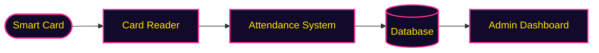

<div align="center">


<a href="https://github.com/nasirhussain-1">

</a>

<br>


<a href="https://github.com/nasirhussain-1?tab=followers">

</a>

</div>


## 🎮 `PLAYER CARD`

```text
╔══════════════════════════════════════════╗
║ PLAYER 1  : Syed Nasir Hussain           ║
║ CLASS     : Computer Systems Engineering ║
║ GUILD     : Developer & Builder          ║
║ MAIN QUEST: Build AI-powered products    ║
║ LEVEL     : Always leveling up           ║
║ STATUS    : Open to collaborate          ║
╚══════════════════════════════════════════╝
```

> 💬 *I love turning ideas into working projects, learning by building, and continuously sharpening my programming and problem-solving skills.*


## 🛠️ `SKILL TREE`

<div align="center">


</div>

## 🔥 `CURRENT MISSIONS`

<div align="center">


<br>


</div>


## ⚔️ `QUEST LOG`

### 🛃 Quest 01: ClearPort
> **Objective:** AI-powered document automation and exception review platform for U.S. customs brokers and freight forwarders, with two-pass AI extraction, validation and a human-in-the-loop exception desk.
>
> **Loot:**
> 
> 
> 
> 

### 🌐 Quest 02: EmbedVerse
> **Objective:** Browser-based 3D simulation platform for embedded systems and robotics, with a community gallery, project forks, likes and follows.
>
> **Loot:**
> 
> 
> 

### 🤖 Quest 03: PromptVault
> **Objective:** An AI-powered prompt improvement app that helps you write better prompts and discover new prompt ideas.
>
> ✨ Prompt improvement &nbsp;•&nbsp; 💡 New prompt suggestions &nbsp;•&nbsp; 🤖 AI-powered enhancement<br>
> 📚 Prompt management &nbsp;•&nbsp; 🎯 Better structured prompts

### 🎓 Quest 04: Smart Attendance System
> **Objective:** A hardware + software university attendance system using smart cards that automates attendance and syncs records straight to a database for admin management.

<details>
<summary><b>🔌 How the Smart Attendance System works</b></summary>



</details>

### 🧪 Side Quests

| Project | What it does |
|:--|:--|
| ⚡ **QuotaGuard** | Chrome extension (Manifest V3) that tracks free-tier message limits across ChatGPT, Claude, Gemini and Perplexity |
| 🎓 **Cody** | Interactive browser-based coding tutor for beginners with XP and quizzes |
| ☕ **Java Quest** | Browser game that teaches Java OOP across 9 sequential worlds |
| ✋ **Air Drawing App** | Draw in the air using hand tracking (MediaPipe Hands + Canvas) |


## 📊 `SCOREBOARD`

<div align="center">


<br><br>


</div>

## 🐍 `SNAKE RUN`

<div align="center">


</div>

## 📈 `ACTIVITY GRAPH`

<div align="center">


</div>


## 🗺️ `LEVEL MAP`

```text
 LVL 1  >>  Data Structures & Algorithms
 LVL 2  >>  Object-Oriented Programming
 LVL 3  >>  Web Development
 LVL 4  >>  Artificial Intelligence
 LVL 5  >>  Cloud & Backend Development
 LVL 6  >>  Cybersecurity
 LVL 7  >>  Real-World Product Development   [ BOSS FIGHT ]
```

## 🏆 `GOALS`

I'm working towards becoming a strong software engineer by learning continuously, building projects and solving real-world problems.

- [ ] 📚 Master core Computer Science concepts
- [ ] 🧩 Get strong at DSA and problem solving
- [x] 🤖 Build practical AI applications
- [ ] 🌐 Become a full-stack developer
- [ ] 🔐 Develop strong cybersecurity skills
- [ ] 🚀 Build and launch useful products
- [ ] 🌍 Work on impactful technology projects

## 🤝 `OPEN TO`

<div align="center">


<br>


</div>


## 📡 `JOIN THE PARTY`

<div align="center">

<a href="mailto:nasirhussain.edu12@gmail.com"></a>
<a href="https://www.linkedin.com/in/syed-nasir-hussain-1b8603381"></a>
<a href="https://github.com/nasirhussain-1"></a>

<br>


</div>

<br>

<div align="center">


</div>
