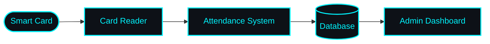

<div align="center">


<a href="https://github.com/nasirhussain-1">

</a>

<br>


<a href="https://github.com/nasirhussain-1?tab=followers">

</a>

</div>


## ⚡ `> whoami`

```yaml
name:      Syed Nasir Hussain
role:      Computer Systems Engineering Student & Developer
mission:   Build practical software, AI products and smart hardware
focus:     [AI, Full-Stack, Embedded Systems, Cybersecurity]
learning:  Always. Building > Watching tutorials
status:    Open to collaborate  🟢
```

> 💬 *I love turning ideas into working projects, learning by building, and continuously sharpening my programming and problem-solving skills.*


## 🛠️ `Tech Arsenal`

<div align="center">

**Languages**<br>
<br><br>

**Web & Backend**<br>
<br><br>

**Embedded & Tools**<br>


</div>


## 🎯 `Current Focus`

<div align="center">


<br>


</div>


## 🚀 `Featured Projects`

<table>
<tr>
<td width="50%" valign="top">

### 🛃 ClearPort
AI-powered document automation and exception review platform for U.S. customs brokers and freight forwarders. Two-pass AI extraction, validation, and a human-in-the-loop exception desk.


</td>
<td width="50%" valign="top">

### 🌐 EmbedVerse
Browser-based 3D simulation platform for embedded systems and robotics, with a community gallery, project forks, likes and follows.


</td>
</tr>
<tr>
<td width="50%" valign="top">

### 🤖 PromptVault
An AI-powered prompt improvement app that helps you write better prompts and discover new prompt ideas.

✨ Prompt improvement &nbsp;•&nbsp; 💡 New prompt suggestions<br>
🤖 AI-powered enhancement &nbsp;•&nbsp; 📚 Prompt management<br>
🎯 Better structured prompts

</td>
<td width="50%" valign="top">

### 🎓 Smart Attendance System
A hardware + software university attendance system using smart cards that automates attendance and syncs records straight to a database for admin management.


</td>
</tr>
</table>

<details>
<summary><b>🔌 How the Smart Attendance System works</b></summary>



</details>

### 🧪 More Builds

| Project | What it does |
|:--|:--|
| ⚡ **QuotaGuard** | Chrome extension (Manifest V3) that tracks free-tier message limits across ChatGPT, Claude, Gemini and Perplexity |
| 🎓 **Cody** | Interactive browser-based coding tutor for beginners with XP and quizzes |
| ☕ **Java Quest** | Browser game that teaches Java OOP across 9 sequential worlds |
| ✋ **Air Drawing App** | Draw in the air using hand tracking (MediaPipe Hands + Canvas) |


## 📊 `GitHub Stats`

<div align="center">


<br><br>


</div>

## 🐍 `Contribution Snake`

<div align="center">


</div>

## 📈 `Activity Graph`

<div align="center">


</div>


## 🧠 `Learning Path`

```text
 Data Structures & Algorithms
              │
              ▼
 Object-Oriented Programming
              │
              ▼
       Web Development
              │
              ▼
   Artificial Intelligence
              │
              ▼
  Cloud & Backend Development
              │
              ▼
        Cybersecurity
              │
              ▼
 Real-World Product Development  🚀
```

## 🎯 `Goals`

I'm working towards becoming a strong software engineer by learning continuously, building projects and solving real-world problems.

- [ ] 📚 Master core Computer Science concepts
- [ ] 🧩 Get strong at DSA and problem solving
- [x] 🤖 Build practical AI applications
- [ ] 🌐 Become a full-stack developer
- [ ] 🔐 Develop strong cybersecurity skills
- [ ] 🚀 Build and launch useful products
- [ ] 🌍 Work on impactful technology projects

## 🤝 `Open To`

<div align="center">


<br>


</div>


## 📡 `Connect With Me`

<div align="center">

<a href="mailto:nasirhussain.edu12@gmail.com"></a>
<a href="https://www.linkedin.com/in/syed-nasir-hussain-1b8603381"></a>
<a href="https://github.com/nasirhussain-1"></a>

<br>

<a href="https://www.youtube.com/@ahmed_907"></a>
<a href="https://www.facebook.com/ahmedjhatial.3"></a>
<a href="https://www.instagram.com/ahmed.jhatyal1"></a>
<a href="https://x.com/jhatial_ahmad"></a>
<a href="https://wa.link/7we2zy"></a>

</div>

<br>

<div align="center">


</div>
