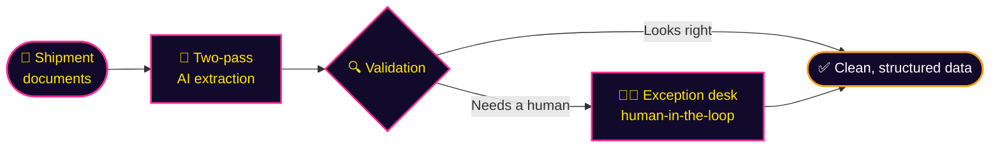
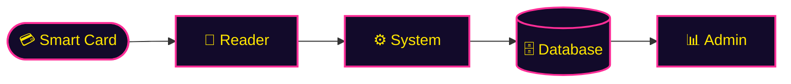
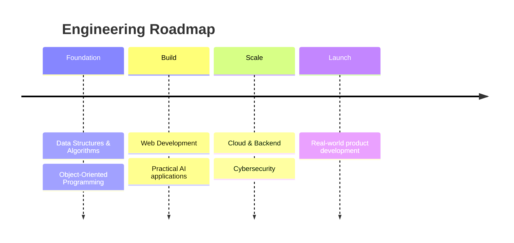

<!--
  Syed Nasir Hussain — GitHub Profile README
  Theme: Neon Midnight  (#120A2A base · #9D4EDD purple · #FF2E97 pink · #FF9F1C orange · #FFE600 yellow)
  Repo name must be exactly your username:  nasirhussain-1/nasirhussain-1
-->

<div align="center">


<a href="https://github.com/nasirhussain-1">

</a>

<br/>

<a href="https://www.linkedin.com/in/syed-nasir-hussain-1b8603381"></a>
<a href="mailto:nasirhussain.edu12@gmail.com"></a>
<a href="https://github.com/nasirhussain-1?tab=repositories"></a>

<a href="https://github.com/nasirhussain-1?tab=followers"></a>

<br/><br/>

**[About](#about-me)** &nbsp;·&nbsp; **[Flagship](#flagship-project)** &nbsp;·&nbsp; **[Projects](#featured-projects)** &nbsp;·&nbsp; **[Stack](#tech-stack)** &nbsp;·&nbsp; **[Analytics](#github-analytics)** &nbsp;·&nbsp; **[Roadmap](#roadmap)** &nbsp;·&nbsp; **[Contact](#lets-build-something)**

</div>


<h2 align="center">About Me</h2>

<table>
<tr>
<td width="55%" valign="top">

```ts
const nasir = {
  name:     "Syed Nasir Hussain",
  role:     "Founder & Builder",
  startup:  "ClearPort",
  studying: "Computer Systems Engineering @ MUET",
  location: "Sindh, Pakistan",
  strengths: ["OOP", "Java", "C++", "Electronics"],
  building: ["AI products", "Full-stack apps", "Embedded sims"],
  mindset:  "Learn by building. Ship early. Iterate fast.",
  openTo:   ["Collaboration", "Startups", "Freelance", "Open Source"],
};
```

</td>
<td width="45%" valign="top">

I'm a **solo founder and engineering student** who loves taking an idea all the way from a blank file to a working product.

At **ClearPort** I handle everything on my own: business development, technical architecture and the product itself. Outside of that, I build tools, games and simulators that sit where **software meets hardware**.

My roots are in **OOP, Java, C++ and electronics**, and today I work across **AI, full-stack web, embedded systems and robotics**.

</td>
</tr>
</table>


<h2 align="center">Flagship Project</h2>

<div align="center">

### 🛃 ClearPort
**AI-powered document automation and exception review for U.S. customs brokers and freight forwarders.**


</div>

Customs brokers lose hours retyping data from shipment paperwork. ClearPort automates that work with **two-pass AI extraction and validation**, and routes only the doubtful cases to a **human-in-the-loop exception desk**, so people spend their time on exceptions, not data entry.




<h2 align="center">Featured Projects</h2>

<table>
<tr>
<td width="50%" valign="top">

### 🌐 EmbedVerse
**Browser-based 3D simulation platform for embedded systems and robotics.**

Build and run hardware projects without owning the hardware. Includes a community gallery with project forks, likes and follows.


</td>
<td width="50%" valign="top">

### 🤖 PromptVault
**AI-powered prompt improvement app.**

Helps you write better prompts, discover new prompt ideas and keep everything organised, with AI-enhanced, better-structured prompts.


</td>
</tr>
<tr>
<td width="50%" valign="top">

### 🎓 Smart Attendance System
**Hardware + software attendance for universities.**

Students tap a smart card, the reader logs it, and records sync straight to a database that admins manage from a dashboard.



</td>
<td width="50%" valign="top">

### ⚡ QuotaGuard
**Chrome extension (Manifest V3).**

Tracks free-tier message limits across **ChatGPT, Claude, Gemini and Perplexity** so you never get cut off mid-task.


</td>
</tr>
</table>

<details>
<summary><b>🧪 More builds: learning tools, games and experiments</b></summary>

<br/>

| Project | What it does |
|:--|:--|
| 🎓 **Cody** | Interactive browser-based coding tutor for beginners, with XP and quizzes |
| ☕ **Java Quest** | Browser game that teaches Java OOP across 9 sequential worlds |
| ✋ **Air Drawing App** | Draw in the air with your hand using MediaPipe Hands + Canvas |

</details>


<h2 align="center">Tech Stack</h2>

<div align="center">

| | |
|:--|:--|
| **Languages** |  |
| **Frontend** |  |
| **Backend & Data** |  |
| **Embedded & Hardware** |  |
| **Tools & Platforms** |  |

</div>


<h2 align="center">GitHub Analytics</h2>

<div align="center">


<br/><br/>


<br/><br/>


<br/><br/>


</div>


<h2 align="center">Roadmap</h2>

<div align="center">




<br/>


</div>


<h2 align="center">Let's Build Something</h2>

<div align="center">

I'm open to **software projects, AI work, startups & SaaS, open source, collaboration, internships and freelance**.
If you have an idea, or just want to talk shop, reach out.

<br/>

<a href="mailto:nasirhussain.edu12@gmail.com"></a>
<a href="https://www.linkedin.com/in/syed-nasir-hussain-1b8603381"></a>
<a href="https://github.com/nasirhussain-1"></a>

<br/><br/>


</div>
